# TechGap frontend, backend and database — design (2026-10-31)

**Status:** The design was approved by the user on 2026-10-31. The diagrams (§3) and the detailed buckets, schema and API (§4–§5) were added afterwards at the user's request and have not been reviewed yet. Not committed. It is planning context, not a claim that anything is built.

**Status legend.** **Confirmed**: the user decided it in the 2026-10-31 brainstorm, or `PLANNED_DATA_FLOW.md` defines it. **Proposed**: written by the assistant and not yet reviewed by the user; subject to change. **Open**: not decided anywhere. §11 lists every part with its status.

**Authority:** [PLANNED_DATA_FLOW.md](../../plan/PLANNED_DATA_FLOW.md) owns what every result means and how it is calculated; the app displays and applies it and never reinterprets it. [SYSTEM_REQUIREMENTS.md](../../requirements/SYSTEM_REQUIREMENTS.md) owns required behavior; pending changes to it are in [PROPOSED_AMENDMENTS_2026-10-31.md](../../requirements/PROPOSED_AMENDMENTS_2026-10-31.md) (not applied). Inputs: [FRONTEND_BACKEND_HANDOFF_2026-10-27.md](../../plan/FRONTEND_BACKEND_HANDOFF_2026-10-27.md).

## 1. Roles

| Role | Sign-in | Features |
| --- | --- | --- |
| Student | No | Student results (track, completed courses, ranked roles, analysis, roadmap) |
| Faculty | No | Faculty results and the printable report |
| Academic Administrator | Yes, invite-only; a developer creates accounts | All Faculty features plus single-course syllabus PDF upload and the status of the resulting recalculation |

Optional student sign-in to save selections is deferred; the API leaves room for it. Not in scope: release rollback UI (a developer switches the active pointer), learning-resource editor (a developer imports a file), user management, curriculum simulation.

## 2. Decisions

| Area | Decision |
| --- | --- |
| Stack | FastAPI (Python) backend; React + TypeScript (Vite) frontend; tables and CSS bars, chart library only if needed |
| Database, storage, auth | Supabase Free: Postgres, private Storage buckets, Auth (invite-only, signups disabled) |
| Hosting | Free only: light FastAPI on a free app host; recompute as a GitHub Actions workflow the API dispatches |
| Versioning | One immutable result release per refresh; users pick a release, default is the active one |
| Retention | Active release plus the 4 most recent in Postgres; older ones stay in the bucket and are re-importable |
| Student data | None stored. Selections persist in the browser only (`localStorage`, keyed by release) |
| Upload | Single-course text-native CICS PDF; accepted when text is extractable and course code and track are extracted; `needs_review`/`issues` carried as warnings; auto-publish |
| Refresh | Syllabus publish triggers recompute; yearly collection starts from a scheduled workflow, disabled until JobStreet's standing consent is recorded (collection plan §8) |
| Student scoring | Backend set logic over stored component-level course support; no model at request time |
| Suggestion text | Deterministic template plus one stored AI rationale per release (Groq, key only in the workflow) |
| Evaluation dataset | A release with manifest `purpose = "controlled_evaluation"` is always labeled and never combined; an app convention, not a contract field |
| Syllabus versions | Each accepted upload creates a new version: the previous version with that course code replaced or added (§7.1) |
| Uploads close together | One recompute at a time; uploads during a run are accepted and queued, and one follow-up run covers the newest version (§7.1) |
| Pipeline input | The API writes the version's syllabus set to a bucket before dispatch; the workflow needs no database credentials (§7.1) |
| Failed recompute | The upload stays accepted, the job is marked failed with its reason, and a developer re-dispatches; no automatic retry (§7.1) |
| Yearly refresh gate | Repository variable `YEARLY_REFRESH_ENABLED`, false by default; only the user sets it, after the JobStreet consent is recorded (§7.2) |
| Yearly failure notice | A failed `jobs` row visible to administrators, plus GitHub's workflow-failure email (§7.2) |

Supabase Free limits checked on its pricing page on 2026-10-30: database 500 MB, storage 1 GB (50 MB per file), egress 5 GB, unlimited REST requests, pause after 1 week of inactivity, no automatic backups. Render's free docs: 750 instance hours, 15-minute idle spin-down, about one minute to wake, "do not use for production".

## 3. Architecture

### 3.1 System architecture (high level)

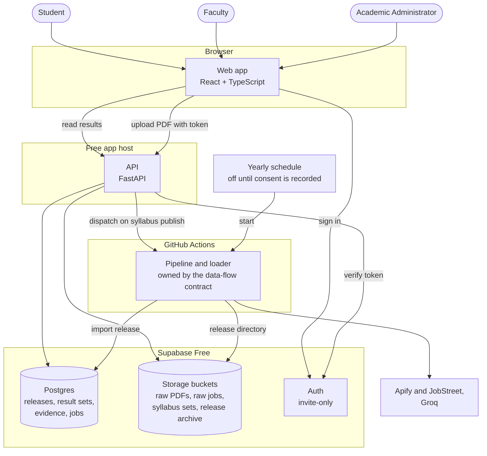

1. Static React app. Public routes call the read API; admin routes need login.
2. FastAPI. Public read endpoints; token-verified upload and job-status endpoints.
3. Supabase: Postgres, buckets, Auth.
4. Pipeline (owned by the data-flow contract) run by a workflow. A loader imports its release directory. The release manifest and result files are the only interface.

### 3.2 Features by role

Each feature is a view of an output defined in `PLANNED_DATA_FLOW.md` §4 (faculty) or §5 (student); the app displays it and does not redefine it. Not in scope: curriculum simulation, student sign-in, release rollback screen, learning-resource editor, user management.

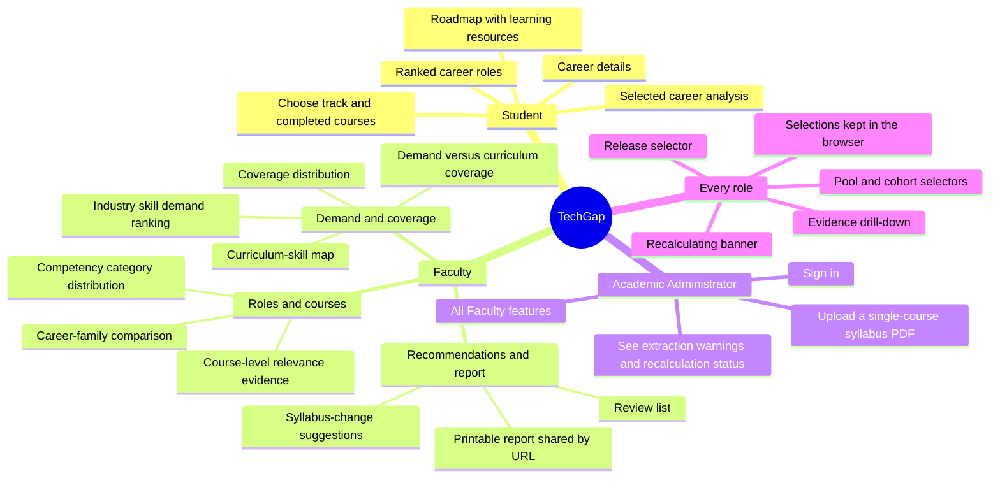

## 4. Data

### 4.1 Storage buckets

Four private Supabase Storage buckets. Nothing is public: the web app never reads a bucket. The API (with the service key) and the workflows do. Object names are hashes or ids, so objects are immutable.

| Bucket | Object path | Content | Written by | Read by | Retention |
| --- | --- | --- | --- | --- | --- |
| `raw-syllabi` | `{sha256}.pdf` | The uploaded single-course syllabus PDF, kept before extraction | API, on upload | Extractor in the API; pipeline | Kept; the app never deletes raw sources |
| `raw-jobs` | `{run_id}.jsonl.gz` | Raw job observations of one collection run, compressed | Collection workflow | Pipeline | Kept |
| `releases` | `{release_id}/manifest.json`, `result_sets/*.json`, `scoring_bundles/*.json`, `evidence.json`, `courses.json` | One release directory, the source of truth the loader imports from | Pipeline workflow, uploaded only after the manifest is complete | Loader | All kept; only the active release plus the 4 most recent are in Postgres |
| `syllabus-sets` | `{version_id}.json` | The full set of syllabus records of one syllabus version, written before the recompute is dispatched | API | Pipeline workflow | Kept (small) |

**Status.** Confirmed: raw syllabus PDFs and raw job payloads are stored before extraction, in buckets; each release directory is archived in a bucket; the database holds only the active release plus the 4 most recent. Confirmed in purpose: the `syllabus-sets` area (the pipeline reads its syllabus input from a bucket). Proposed: the four separate bucket names, the exact object paths, "all releases kept", and the list of files in a release. Open: where a failed run's `failure.json` is kept.

Sizes measured locally: syllabus PDFs about 49 MB (119 files), raw job payloads about 59 MB uncompressed, against 1 GB of free storage and a 50 MB limit per object. Where a failed run's `failure.json` is kept is decided in Plan C. The release file format is in `docs/plan/RELEASE_FORMAT.md` (draft, created by Plan A Task 6).

### 4.2 Postgres schema

Types shown are Postgres types; JSON columns are `jsonb` on Postgres and plain JSON in the SQLite tests. Timestamps are ISO-8601 text, as the release stores them. Plan A adds no secondary indexes; add an index on `(release_id, pool, cohort, scope_type, scope_id)` if result-set lookups become slow.

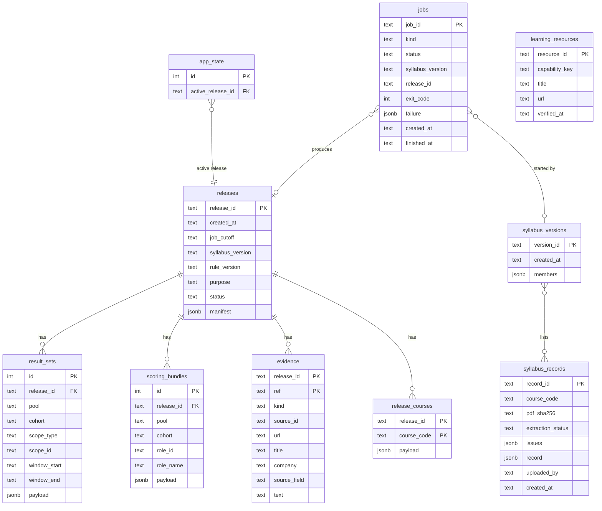

**Status.** Confirmed: the table names `releases`, `app_state`, `result_sets`, `scoring_bundles`, `evidence`, `syllabus_versions` with syllabus records, `learning_resources` and `jobs`, and what each one is for (approved in the 2026-10-31 spec). Proposed: every column and type below, the new table `release_courses`, and all Plan C columns and status values. Nothing below has been reviewed column by column.

**Built in Plan A** (columns exactly as in `webapp/api/techgap_api/db.py` in the plan):

| Table | Purpose | Key columns and notes |
| --- | --- | --- |
| `releases` | One row per imported release | `release_id` is the primary key. `status` is `ready`, `building` or `failed`; only `ready` releases are served. `purpose` is free text (`controlled_evaluation` is an app convention). `manifest` keeps the full manifest |
| `app_state` | Which release is active | One row, `id = 1`. Changing `active_release_id` activates or rolls back a release |
| `result_sets` | Precomputed faculty-view payloads | Keyed by release, pool, cohort, scope (`track`, `role` or `overall`) and scope id. Each row carries its own observation window. A pool with no releasable data has no rows |
| `scoring_bundles` | Data the backend scores students from | One row per release, pool, cohort and role. `payload` holds each posting's requirement groups (alternatives, each an AND of components, plus `requirement_unresolved`) and each component's supporting courses with passage reference and status (`supported` or `unresolved` only). Loaded into memory once per release |
| `evidence` | Drill-down text | A posting shows title, company, URL and the short extracted phrase only. A syllabus passage is shown in full, with its `source_field` |
| `release_courses` | Courses in the release's syllabus version | `payload` has title (nullable), track, year level, semester, extraction status and CMO knowledge area (null means unmapped) |

**Proposed for Plan C** (columns are a starting point and are finalized in that plan):

| Table | Purpose | Notes |
| --- | --- | --- |
| `syllabus_records` | One row per accepted upload | `pdf_sha256` points to the object in `raw-syllabi`. `record` is the extracted syllabus JSON. `extraction_status` and `issues` carry warnings. `uploaded_by` is the Supabase Auth user id |
| `syllabus_versions` | A syllabus version, as the set of records it uses | `members` maps each course code to a `record_id`. The release manifest's `syllabus_version` refers to a `version_id` |
| `jobs` | Recompute and refresh runs | `kind` is `syllabus_publish` or `yearly_refresh`; `status` is `queued`, `running`, `succeeded` or `failed`; `exit_code` and `failure` come from the pipeline entry command (0 success, 1 data failure, 2 error) |
| `learning_resources` | Verified resources a roadmap links to | Keyed by `capability_key`. The key rule is open item P6, so this table stays provisional |

Not stored: student selections, names, or any account other than Academic Administrators (those live in Supabase Auth). The CMO 25 reference is a fixed file in the repository. The database is rebuildable from the `releases` bucket except `learning_resources` and `jobs`, which need a periodic export (Supabase Free has no automatic backups).

## 5. API

### 5.1 Conventions

- JSON over HTTPS. There is no URL version; a request names the release it reads, and a release never changes after it is imported.
- Public endpoints need no sign-in and set no cookies. Student `POST` bodies are scored and discarded; nothing about a student is stored.
- Academic Administrator endpoints need `Authorization: Bearer <Supabase Auth access token>`. How the API verifies the token is chosen in Plan C.
- Errors use FastAPI's `{"detail": ...}` body: `404` unknown or not-ready release or evidence, `422` invalid parameter, body or unknown course ID, `401` missing or invalid token, `413` upload too large.
- Responses for one release are immutable and may carry long cache headers. `/releases` and `/status` must not be cached.
- `/releases/{release_id}/...` always names a release; the web app takes the default from `GET /releases` (the one with `active: true`).

**Status.** Confirmed: public endpoints need no sign-in, Academic Administrator endpoints need sign-in, and nothing about a student is stored. Proposed: JSON conventions, the error codes, caching headers, the bearer-token format and having no URL version. Open: how the API verifies the token.

### 5.2 Endpoints

| Method | Path | Auth | Purpose | Built in | Status |
| --- | --- | --- | --- | --- | --- |
| GET | `/health` | none | Liveness check, also used by an uptime monitor | Plan A | Proposed |
| GET | `/releases` | none | Ready releases, newest first: id, created_at, job cutoff, syllabus version, rule version, purpose, `active` | Plan A | Capability confirmed; path and fields proposed |
| GET | `/releases/{release_id}/meta` | none | Release summary: versions, `pools` mapped to their cohorts (an absent pool is missing), `roles` (pool, cohort, role id, role name), `courses` | Plan A | Capability confirmed; path and fields proposed |
| GET | `/releases/{release_id}/result-sets` | none | Faculty-view payloads. Optional filters `pool`, `cohort`, `scope_type`, `scope_id`. Each item: those keys, `window_start`, `window_end`, `payload`. An invalid filter value returns `422` | Plan A | Capability confirmed; path, filters and fields proposed |
| GET | `/releases/{release_id}/evidence/{ref}` | none | One piece of evidence: `kind`, `source_id`, `url`, `title`, `company`, `source_field`, `text` | Plan A | Capability confirmed; what a job may show (title, company, URL, phrase) is confirmed by the contract; path and fields proposed |
| GET | `/status` | none | Whether a recalculation is running: active release id, `recalculating`, the release being built if any. Feeds the banner | Plan C | Proposed (the banner is confirmed; this endpoint is new) |
| GET | `/releases/{release_id}/tracks/{track_id}/courses` | none | Courses applicable to a track, grouped by year and semester, following the handoff's applicability table. Courses whose applicability is unresolved are flagged, never broadcast | Plan D | Proposed (the applicability rules are confirmed in the handoff; this endpoint is new) |
| POST | `/releases/{release_id}/student/ranking` | none | Ranked career roles for a student's completed courses | Plan D | Capability and result rules confirmed (contract §3, §5); path, request and response fields proposed |
| POST | `/releases/{release_id}/student/analysis` | none | One role's analysis for the student | Plan D | Same as ranking |
| POST | `/releases/{release_id}/student/roadmap` | none | Gaps for one role, with learning resources | Plan D | Same as ranking |
| POST | `/admin/syllabi` | Academic Administrator | Upload one syllabus PDF (multipart). Validates type and size, stores it, extracts, accepts or rejects, and starts the recalculation | Plan C | Capability and acceptance rules confirmed; path, multipart format and response proposed |
| GET | `/admin/jobs` | Academic Administrator | Recent jobs, newest first | Plan C | Proposed (new) |
| GET | `/admin/jobs/{job_id}` | Academic Administrator | One job: status, linked syllabus version and release, exit code, failure reason | Plan C | Capability confirmed (job status); path and fields proposed |

There is no endpoint for the printable report or for the faculty views as such: the report page is built in the browser from the same `result-sets` calls, and its URL (`release`, `track`, `pool`, `cohort`) reproduces the same content for the same release. There are also no endpoints to edit resources, to roll back a release, or to manage users; those are developer actions.

### 5.3 Student endpoints (proposed; the exact schemas are fixed in Plan D as response models)

**Status.** Confirmed by the contract: ranking order and ties, "no score" roles last and selectable, scored / qualified / not-scored counts, bounds, the roadmap's gaps and "not confirmed" list, "possible later", and that future courses never count. Proposed: the endpoint names and every request and response field name below.

- **Request body, all three:** `pool`, `cohort`, `track`, `completed_course_ids` (a list). The analysis and roadmap bodies also carry `role_id`. Course IDs are checked against the release's courses and the track's applicable courses; an unknown ID returns `422`. Future courses never enter the score.
- **`ranking`:** roles ordered by combined alignment, highest first. Equal figures share a rank and are listed in role-name order. Roles with no scored posting follow, labeled "no score", in name order, and stay selectable. Each role carries `role_id`, `role_name`, rank (null for no score), `combined_alignment` (null when no posting is scored), counts of scored, qualified, not-scored and total postings, and the competencies driving the ranking.
- **`analysis`:** the role's combined alignment and the list of postings, each marked scored, qualified (with lower and upper bound) or not scored; the status of each required capability for the student's courses (covered, partial, missing or unresolved) with the supporting completed courses and evidence references; gaps; and "possible later" shown separately.
- **`roadmap`:** missing groups and partial groups (with the unsupported components named) ordered together by observed demand `n/N`; unresolved groups listed separately as "not confirmed"; a verified learning resource where one exists for the capability key. It is ordered by demand, not by prerequisites.
- **Rules applied:** `PLANNED_DATA_FLOW.md` §3 (status of a component, alternative and group for a course set; `requirement_unresolved`; scored, qualified and not-scored postings; bounds; unweighted mean) and §5. The API applies them and never changes them.

Faculty views (the contract's §4 outputs, including the Review list and syllabus-change suggestions) are read as `result-sets` payloads. The payload shape per view is not fixed in release format v0.

### 5.4 Scoring and release format

- **Scoring:** one pure module applies the contract's §3 rules and decisions D2a–D2c. Every mean is shown with "N scored / N qualified / N not scored".
- **Release format:** `docs/plan/RELEASE_FORMAT.md` defines the files; it is the interface to the pipeline session.

## 6. Frontend

Routes: `/` role chooser; `/student`; `/faculty`; `/report?release=&track=&pool=&cohort=` (print page, reproducible by URL); `/admin/login`; `/admin/upload`. Header on every page: release selector (controlled-evaluation label), pool and cohort selectors, "recalculating, showing release X" banner.

Shared components enforce the display rules: `n/N` on every count; "N scored / N qualified / N not scored" on every mean; bounds for qualified postings; no score when a role has no assessable postings; unresolved never shown as missing; status by text as well as color; the "academic match, not mastery or hiring probability" notice; employment and internship apart; pools never mixed; "no data yet" for an absent pool; the CMO 25 notice on recommendations. Stored selections are checked against the release's course list; unknown IDs are dropped with a notice.

## 7. Flows

Every process in the system has a diagram below. The diagrams show how the confirmed decisions fit together; where a step is only proposed, the text under the diagram says so. The meaning of every result stays in `PLANNED_DATA_FLOW.md`.

### 7.0 End-to-end data flow

**Status.** The pipeline stages are the contract's section 2 (confirmed) and are owned by the data-flow session. The loader and API steps are confirmed in the approved design.

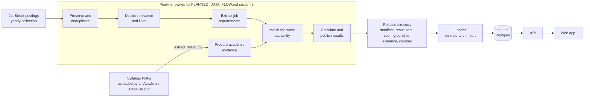

### 7.1 Syllabus versions and recompute

**Status.** Confirmed by the user on 2026-10-31 except where a line says proposed.

- **Version rule.** Each accepted upload creates a new `syllabus_versions` row: the previous version's `members` with that `course_code` replaced or added. A lecture and a lab have different course codes and are separate courses. Earlier versions and records are never changed or deleted.
- **Pipeline input.** Before dispatching, the API writes the new version's full set of syllabus records to `syllabus-sets/{version_id}.json`. The workflow reads it from the bucket and needs no database credentials.
- **One recompute at a time.** An upload while a job is `queued` or `running` is accepted and recorded. When the running job ends, one follow-up job covers the newest version, which already contains every accepted upload. An intermediate version can therefore never get a release of its own; it stays stored.
- **Job data (proposed).** A syllabus recompute reuses the active release's job cutoff and saved job registry, so only the syllabus side changes. This follows data-flow decision D6b, which is not yet verified in the contract.
- **Failure.** The upload stays accepted. The job is marked `failed` with the reason from `failure.json`, the uploader sees it on the upload page, and the previous release stays active. A developer re-dispatches; there is no automatic retry.
- **Success.** Exit code 0: the loader imports the release and activates it. The banner clears.

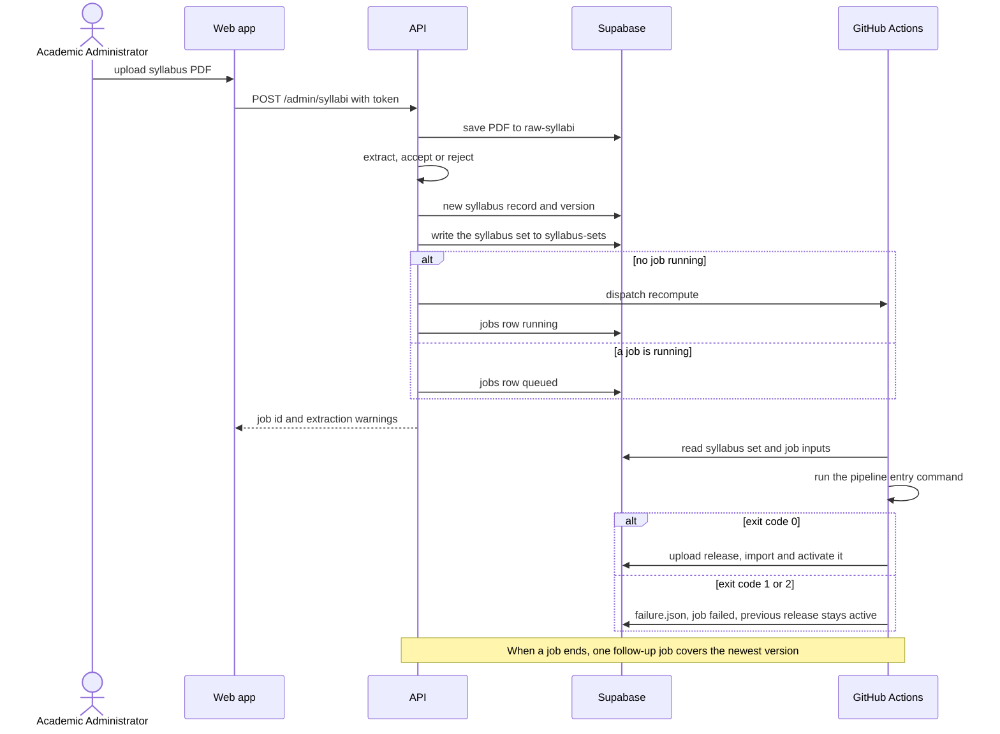

### 7.2 Yearly job refresh

**Status.** Confirmed by the user on 2026-10-31 except where a line says proposed or open.

- **Trigger.** A scheduled GitHub Actions workflow, once a year. It is gated by the repository variable `YEARLY_REFRESH_ENABLED`, false by default; the workflow stops at once unless it is true. Only the user sets it, after JobStreet's standing written consent is recorded (collection plan §8).
- **Limits.** The USD 5 yearly ceiling, the frozen query list and the stop rules belong to the collection plan and are enforced by the collection process, not by the web app.
- **Output.** The raw run goes to `raw-jobs/{run_id}.jsonl.gz`. The pipeline writes a new release, the loader imports it and activates it on success. Older releases stay selectable under the retention rule.
- **Failure or abort.** A `jobs` row is marked `failed` with its reason and is visible in `/admin/jobs`; GitHub also sends its workflow-failure email (not verified for scheduled runs). The previous release stays active.
- **Syllabus used (proposed).** The syllabus version that is active when the refresh starts.
- **International pool.** It has no yearly plan yet (collection plan §8), so it has no result set until one exists.
- **Open (collection and data-flow sessions).** Where the frozen saved-ID registry lives (suggested: the `raw-jobs` bucket beside its run); where the classifier's model files live (repository `models/` or a bucket); the classifier retraining rules, which are still proposals in the contract. Unverified: whether GitHub disables a yearly schedule after inactivity.

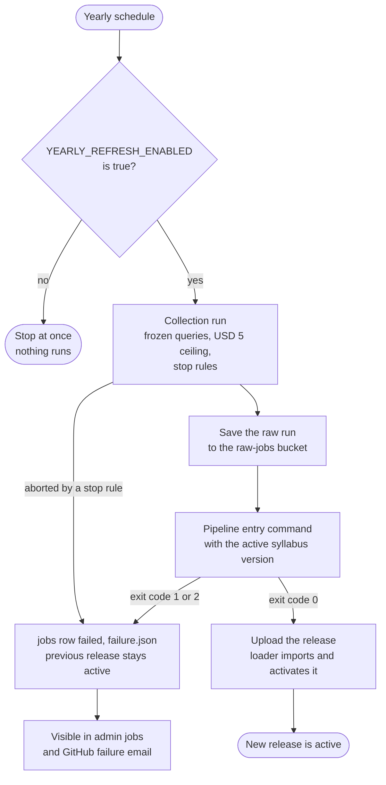

### 7.3 Release loading, activation and lifecycle

**Status.** Confirmed in the approved design: the loader validates the manifest, hashes and schema, inserts in one transaction, and activation moves a pointer; a failed load leaves the previous release active. Proposed: the lifecycle states below and the archive rule's mechanics (Plan C).

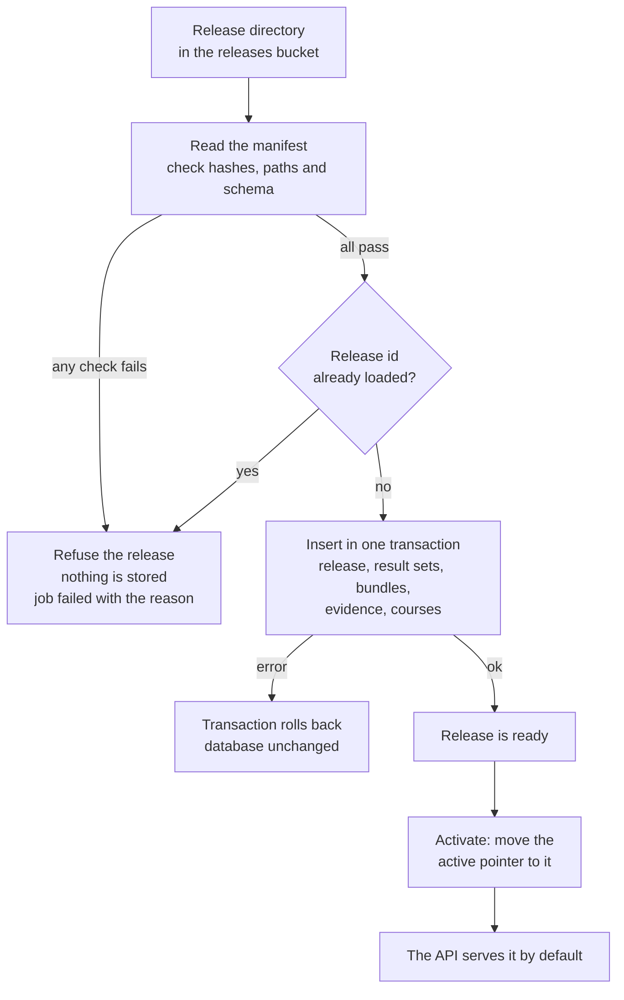

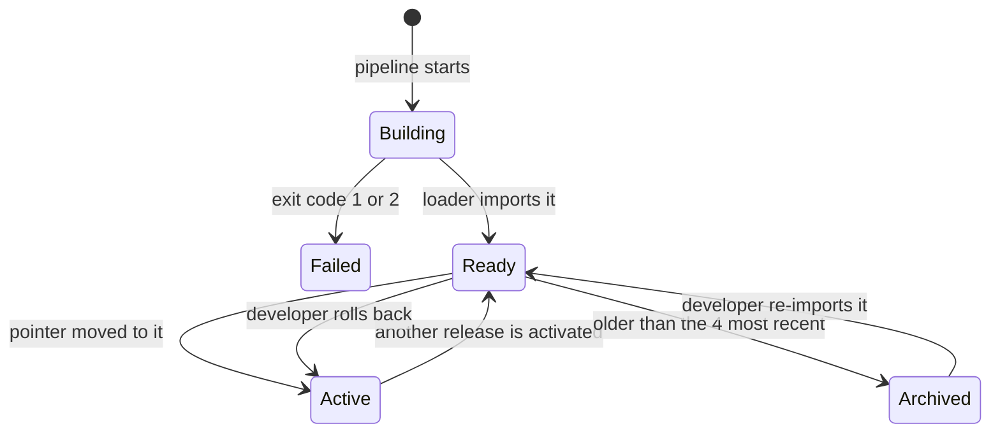

Only the active release and the 4 most recent are in Postgres. An archived release stays in the `releases` bucket and can be re-imported by a developer. A developer rolls back by activating an earlier ready release; there is no screen for it.

### 7.4 Student request and scoring

**Status.** Confirmed by the contract: the scoring rules in the second diagram (`PLANNED_DATA_FLOW.md` sections 3 and 5), and that nothing about the student is stored. Proposed: the order of calls and the endpoint names in the first diagram.

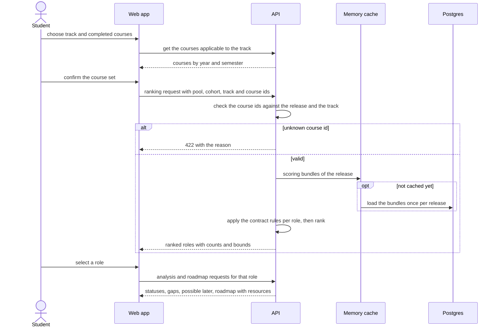

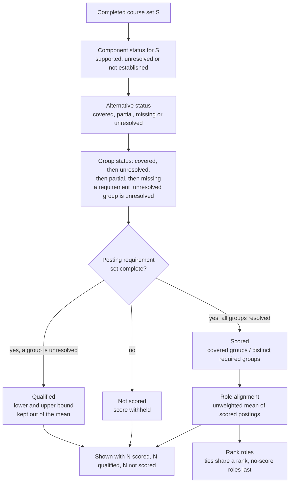

### 7.5 Faculty views and the report

**Status.** Confirmed: faculty views and the report are built from the release's stored results, and the report URL reproduces the same content for the same release. Proposed: the call order below.

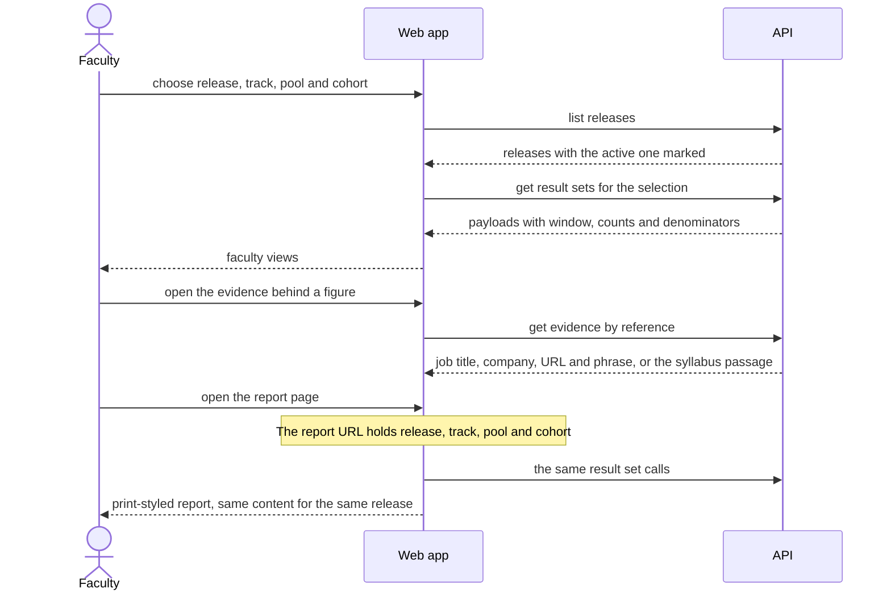

### 7.6 Selections kept in the browser

**Status.** Confirmed: selections are kept only in the user's browser, keyed by release, checked against the release's course list, and unknown course ids are dropped with a notice. Open: what happens to a selection saved under a release that is no longer available.

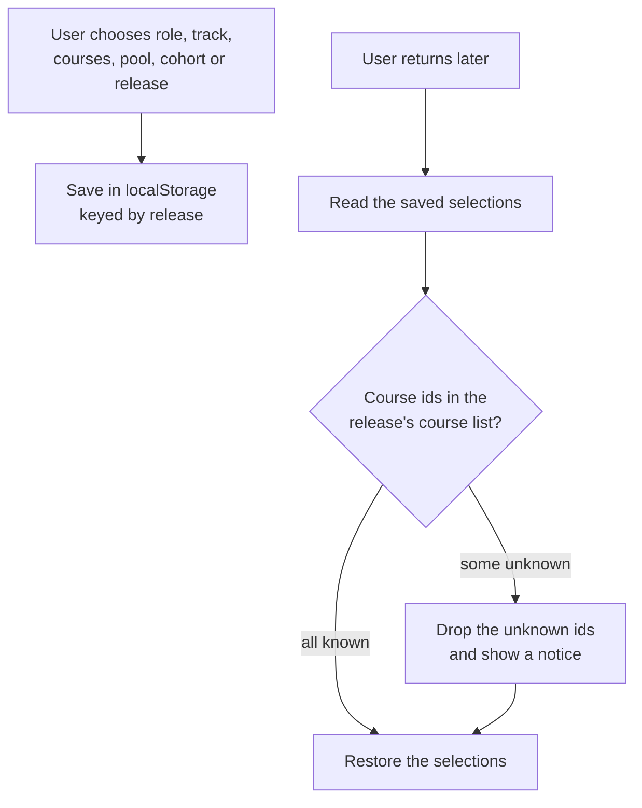

### 7.7 Mock-first development

**Status.** Confirmed: the pipeline stages for retrieval, support and grouping are not built, so the app is built against a mock release first. The mock covers a role with zero assessable postings, qualified and incomplete postings, an empty pool, an unmapped course, a `needs_review` course, a sparse role and a demand tie.

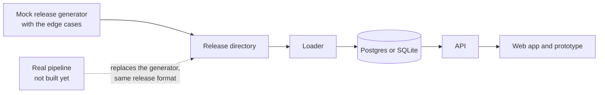

## 8. Security, errors, tests

- Token check on upload endpoints; PDF type and size validation; student course IDs validated against the release; no personal data stored; CORS limited to the app origin.
- Apify, Groq, GitHub dispatch and Supabase service keys only in server or workflow environments; never in logs, URLs, config, manifests or chat.
- Tests: unit tests for the scoring module from contract examples; loader schema and failure tests; API contract tests against the mock release; one smoke path for student, faculty and upload.

## 9. Dependencies and open items

- **Approved by the user:** D1 (component-level support links), D4 (pool with no data) and D5 (unmapped CMO state) now appear in the contract text. D6b/c (incremental rematch; temp-directory build and rename) and D7 (entry command and exit codes) were not re-checked; confirm them in `PLANNED_DATA_FLOW.md` section 7. Only the data-flow session edits the contract.
- **Decided in the contract (2026-10-31):** group status for a course set (P1), bounds (P2), combined alignment (P3), ranking (P4), roadmap gaps and "possible later" (P5), Review list (P7), public display of jobs as title, company, URL and extracted phrase (P8). **Still open:** the capability registry (P6) and the release-format review (P9).
- **Requirements amendments** await the user's approval; nothing in `SYSTEM_REQUIREMENTS.md` has been edited.

## 10. Risks (unverified or unresolved)

Free hosting is not for production and cold-starts; Supabase Free pauses after inactivity and has no backups (learning resources and admin data need a periodic export; the DB is otherwise rebuildable from the buckets); no automatic yearly run until the JobStreet consent is recorded; `scoring_bundles` size and memory depend on real pipeline output; the extractor is verified only for text-native DLSU-D CICS PDFs; GitHub's disabling of scheduled workflows in inactive repos is from recollection and unchecked.

## 11. Status of each part

Use this table to see what can change. "Changes through" says who or what would change it.

| Part | Status | Source | Changes through |
| --- | --- | --- | --- |
| Three roles; Student and Faculty need no sign-in; Academic Administrator signs in, invite-only, accounts created by a developer; Academic Administrator has all Faculty features plus syllabus upload | Confirmed | User, 2026-10-31 | The user |
| FastAPI + React/TypeScript; Supabase Free (Postgres, Storage, Auth); free hosting; recompute as a GitHub Actions workflow | Confirmed | User | The user; hosting risks in §10 |
| One immutable result release per refresh; users pick a release; active plus 4 most recent in Postgres | Confirmed | User | The user |
| No student data stored; selections kept in the browser only | Confirmed | User | The user |
| Upload rules: single-course text-native CICS PDF; accepted when text is extractable and course code and track are extracted; warnings carried; auto-publish | Confirmed | User; data-flow decision D6a | The user |
| Yearly refresh by scheduled workflow, off until JobStreet consent is recorded | Confirmed | User; collection plan §8 | The user |
| Student scoring by the backend from stored data, no model at request time | Confirmed | User | The user |
| Template suggestion text plus one stored AI rationale per release | Confirmed | User; contract §6 | The user |
| Release `purpose = controlled_evaluation` labeled and never combined (app convention) | Confirmed | User | The user |
| No rollback screen, resource editor or user management (a developer does these) | Confirmed | User | The user |
| All result meanings and formulas: group status, bounds, combined alignment, ranking, roadmap, "possible later", Review list, public display of a job | Confirmed | `PLANNED_DATA_FLOW.md` | The data-flow session, with the user's approval |
| Display rules and frontend routes (§6) | Confirmed in the approved design; screens not defined | User; contract | The HTML prototype and the user |
| The two diagrams (§3) | Illustrate confirmed decisions; layout and wording proposed | Assistant, at the user's request | The user |
| Bucket names, object paths, the file list of a release (§4.1) | Proposed | Assistant | The user; release format with the data-flow session (P9) |
| Every column and type; the table `release_courses`; Plan C tables (§4.2) | Proposed | Assistant | The user; Plan A and Plan C review |
| Endpoint paths, request and response fields, and the endpoints `/health`, `/status`, track courses and `/admin/jobs` (§5.2, §5.3) | Proposed | Assistant | The user; Phase 0 and Plan D |
| JSON, error codes, caching headers, bearer-token format (§5.1) | Proposed | Assistant | The user |
| Release format v0 and the mock release (Plan A) | Proposed | Assistant | The data-flow session (P9) |
| Plan A (written), Plans B–D (not written) | Plan A proposed; B–D open | Assistant | The user |
| Capability key rule (P6) | Open | Data-flow session | The data-flow session |
| Where `failure.json` is kept; how the API verifies the Supabase token; payload shape of faculty views | Open | None yet | Plan C; release format review |
| D6b/c and D7 present in the contract | Not verified | Not re-checked | `PLANNED_DATA_FLOW.md` §7 |
| Requirements amendments (roles, simulation removed, international pool, FR-T07 wording) | Drafted, not approved | `PROPOSED_AMENDMENTS_2026-10-31.md` | The user |
| Curated role list | Draft, not approved | `CURATED_ROLE_LIST_DRAFT_2026-10-27.md` | The user |
| Screens, layout and interactions | Open | None yet | HTML prototype, then the user |
| Syllabus version rule; one recompute at a time with uploads queued and one follow-up run; pipeline reads the syllabus set from a bucket; a failed recompute keeps the upload and needs a developer re-dispatch (§7.1) | Confirmed | User, 2026-10-31 | The user |
| Yearly refresh gate `YEARLY_REFRESH_ENABLED` (false by default) and the failure notice (§7.2) | Confirmed | User, 2026-10-31 | The user; GitHub's notification behavior is unverified |
| Bucket name and path `syllabus-sets/{version_id}.json`; a syllabus recompute reusing the active release's job cutoff and registry; the yearly refresh using the active syllabus version (§7.1, §7.2) | Proposed | Assistant | The user; data-flow decision D6b |
| Where the frozen saved-ID registry and the classifier model files live (§7.2) | Open | None yet | Collection and data-flow sessions |
| Flow diagrams in §7 | Illustrate confirmed decisions; the order of calls in 7.4 and 7.5 and the lifecycle states in 7.3 are proposed | Assistant, at the user's request | The user |
| What happens to a browser selection saved under a release that is no longer available (§7.6) | Open | None yet | The user |
